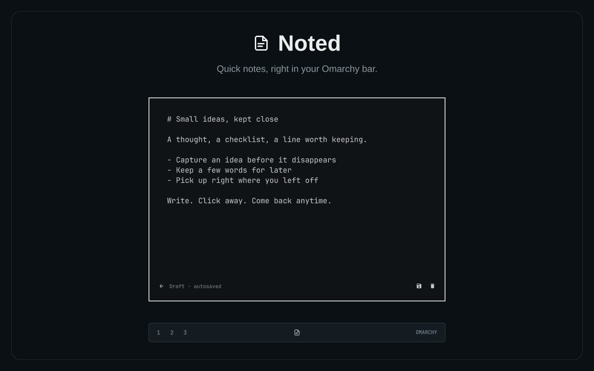

# Noted

Quick notes, right in your Omarchy bar.



Click the icon, write, click away. Noted saves while you type, so there's
nothing to remember and nothing to lose. Every note is a plain Markdown file.

## Install

```sh
omarchy plugin add https://github.com/KroxiDev/omarchy-noted --enable
```

That's it. Noted needs Omarchy 4 and uses only what a standard install already
includes.

It shows up in the middle of the bar. To move it, use the bar settings.

## How to use it

- **Click** the icon to open or hide Noted.
- **Right-click** the icon, or press **+**, to start a new note.
- **Write.** Noted saves as you go. Close it whenever you like and your note is
  still there, right where you left it.
- **←** takes you back to your notes.
- **Click the trash icon twice** to delete a note. It goes to your Trash, and
  **↶** brings it back.

You never have to save. If you want a note as a file with a name of your
choice, press **Ctrl+S**. Saved notes go to `Documents/Noted` by default.

| Key | What it does |
| --- | --- |
| **Esc** | Hide Noted |
| **Ctrl+S** | Save the note as a file |
| **Ctrl+Shift+S** | Rename or move the file (also: right-click the save icon) |
| **Ctrl+Z** | Undo typing. In the list, bring back the last deleted note |

## Open it with a shortcut

Noted doesn't add shortcuts on its own. To open it with **Super+N** (free on a
stock Omarchy), add this line to `~/.config/hypr/bindings.lua`:

```lua
o.bind("SUPER + N", "Noted", "omarchy-shell krox.noted toggle")
```

Change `toggle` to `newNote` if you'd rather jump straight into a new note.

## Settings

Noted works without any setup. To change where saved notes go or the language
(English or Spanish, chosen automatically), use the bar settings or run:

```sh
omarchy bar set krox.noted folder ~/Notes
omarchy bar set krox.noted language es
```

Any `.md` file you put in that folder shows up in Noted too.

## Update or remove

```sh
omarchy plugin update krox.noted
omarchy plugin remove krox.noted
```

Removing Noted keeps your notes. If you added a shortcut, remove that line too.

## More

Curious how Noted stores your notes, handles changes made by other apps, or
recovers text after a failed save? See [How Noted works](docs/how-it-works.md).

## License

[MIT](LICENSE)
